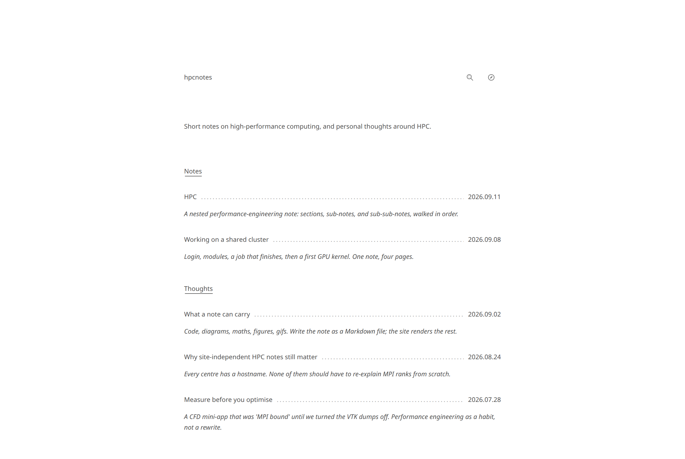

# hpcnotes



Short notes on high-performance computing. Source of [hpcnotes.eu](https://hpcnotes.eu).

## Run

```bash
npm install
npm run dev        # http://127.0.0.1:43123
```

| Script | |
| --- | --- |
| `npm run build` / `npm start` | Production build / serve |
| `npm run new -- my-slug` | New draft note |
| `npm run check` | Lint, typecheck, tests (incl. broken links and missing media) |

## Write

Notes live in `src/content/notes/<slug>.md`:

~~~md
---
title: Login nodes are not compute
date: 2026-09-02
updated: 2026-10-01            # optional
summary: One line for lists and search.
tags: slurm, etiquette
kind: note                     # or thought (default)
parent: working-on-a-cluster   # optional: makes this a page of that note
order: 1
draft: false
---

Markdown, $math$, mermaid fences, ,
and links to [[other-note]] or [[other-note|a label]].
~~~

Media go in `public/media/`. Drafts only show in `npm run dev`.

## Layout

```
src/content/      notes, loaders, search
src/app/          routes, RSS, sitemap, llms.txt
src/components/   UI (Astryx)
```

## Environment

All optional, see `.env.example`: `NEXT_PUBLIC_SITE_URL`, AdSense IDs, `GOOGLE_SITE_VERIFICATION`.
