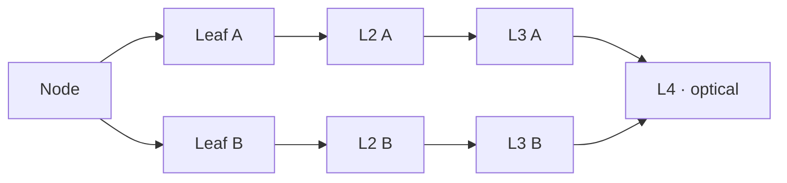

In June 2026, LineShine took first place on the TOP500. It runs HPL at 2.198 EFlop/s, about 21% ahead of El Capitan, and it does it without a single GPU. Every flop comes from Arm CPUs. The National Supercomputing Center in Shenzhen (NSCS) operates it.

The last Chinese machine at the top was Sunway TaihuLight, in 2017. China had stopped submitting to the list after 2019, and the usual explanation is US export controls on high-end GPUs. LineShine is the answer to that constraint. If you cannot buy accelerators, you build a CPU wide enough to act like one.

A caveat before the numbers. Most of what is public comes from an NSCS paper, the TOP500 entry and press analysis. A few figures disagree between sources. I flag those where they come up, and I mark the numbers I derived myself.

## The numbers that matter

| | LineShine | El Capitan |
| --- | --- | --- |
| HPL (Rmax) | 2,198.4 PFlop/s | 1,809 PFlop/s |
| Peak (Rpeak) | 2,735.8 PFlop/s | |
| HPL / peak | 80.4% | |
| Power during HPL | 42.2 MW | |
| Efficiency | 52.1 GFlop/s per W | 60.9 GFlop/s per W |
| Cores | 13,789,440 | |
| HPCG | 22.0 PFlop/s, first | |

So LineShine is the fastest machine on the list, but not the most frugal: it draws 42 MW, where Frontier, El Capitan and Aurora each stay under 30 MW. That is the cost of doing everything on CPUs.

## From the cabinet down to the core

| Level | Holds | In the HPL run |
| --- | --- | --- |
| System | 90 compute cabinets | |
| Cabinet | 2 frames | |
| Frame | 16 blades | |
| Blade | 8 nodes, linked by PCIe 5.0 | |
| Node | 2 LX2 sockets, 608 cores | 22,680 nodes |
| Socket | 2 dies, 304 cores | 45,360 sockets |
| Die | 4 NUMA domains of 38 cores | 90,720 dies |

The counts are consistent with each other: 90 × 2 × 16 × 8 gives 23,040 node slots. The HPL run used 22,680 nodes, which is 98% of them, and 22,680 × 608 is exactly the 13,789,440 cores on the list. The NSCS paper describes a smaller configuration of 20,480 nodes, which is probably what was installed when it was written.

## The LX2 chip

LX2 is an Armv9 processor with SVE2 vector units and SME matrix units. NSCS has not said who designed it; most analysts attribute it to Huawei's HiSilicon. A socket holds two compute dies of 152 cores each. Each die is split into four NUMA domains of 38 cores, and each domain has its own slice of HBM and DDR5.

| Per socket | Value |
| --- | --- |
| Cores | 304 at 1.55 GHz |
| FP64 peak | 60.3 TFlop/s |
| FP32 peak | 120.6 TFlop/s |
| HBM | 32 GB, about 4 TB/s (reported) |
| DDR5 | 256 GB, off package |
| Power | about 690 W (reported) |

The figure worth doing by hand is the throughput per core:

$$
\frac{60.3 \times 10^{12}}{304 \times 1.55 \times 10^{9}} \approx 128 \ \text{FP64 flop per cycle per core}
$$

That is a lot for a CPU core. A 512-bit SVE unit with two FMA pipes gives 32, so 128 points at the SME matrix unit doing the work: an 8 × 8 outer product of FP64 values is 64 FMAs, or 128 flops, per cycle. This is my derivation, not a published figure. It would also explain why the clock is so low: 1.55 GHz leaves the power for wide math rather than speed.

### Memory, and the one figure people disagree on

The NSCS paper lists eight HBM stacks per socket, 32 GB in total at 4 TB/s. The Next Platform reads the die layout as sixteen stacks, 64 GB at 8 TB/s. Until NSCS publishes a datasheet, treat both as candidates.

The ratio is what matters for real code. At 4 TB/s for 60.3 TFlop/s, a socket gets about 0.066 bytes per flop, close to a Frontier MI250X (3.2 TB/s for 47.9 TFlop/s). In other words, LineShine has the bandwidth balance of a GPU machine. A stencil or a sparse solver will be bound by memory long before it reaches the SME units. The HPCG result agrees: 22 PFlop/s is 0.8% of peak, which is typical of every large machine, GPU or not.

Behind the HBM sits 256 GB of DDR5 per socket, with an SDMA engine that moves data between the two tiers. That is a capacity tier, much like the LPDDR5X behind an NVIDIA Grace. Something has to decide what lives in HBM, and on LineShine that is your problem or your runtime's.

## The LingQi network

Each node gets 1.6 Tb/s of network bandwidth, and press reports put the NIC inside the package. The fabric is called LingQi and was designed in China.

It is a four-layer fat tree, built as two independent planes with several rails per node. Links are copper inside a frame and optical up to the top layer. The published figures are a single-hop latency of 1.07 µs and more than 3.5 Pb/s of bisection bandwidth. HPCwire describes InfiniBand-like features such as credit-based flow control; others suspect an Ethernet variant. Nobody outside NSCS knows yet.

One more line of arithmetic: 200 GB/s per node for 120.6 TFlop/s is about 0.0017 bytes per flop. That is normal for an exascale machine. What it means is that a well-written code keeps its halo exchanges small and its collectives rare, on LineShine as on Frontier.

## Software

The nodes run Kylin, a Chinese Linux distribution. Being Armv9, the machine inherits the Arm HPC ecosystem: GCC, LLVM, SVE intrinsics, and any MPI that speaks to the LingQi NIC. Getting SME used by real applications, not just by HPL's DGEMM, is the open question. Today that mostly means BLAS libraries and compilers that know how to emit matrix instructions.

## What to take from it

- An exaflop on CPUs alone is possible. It costs at least 40% more power than the GPU machines it beat.
- The matrix unit is the accelerator. It just happens to live inside each core instead of on a separate card.
- For memory-bound code the machine looks like a GPU system: about 0.07 bytes per flop from HBM, and a second, slower DDR tier to manage.
- 80% HPL efficiency is good but not exceptional; Fugaku reached 82%.

Sources: the [TOP500 June 2026 list](https://top500.org/lists/top500/2026/06/), [The Next Platform](https://www.nextplatform.com/hpc/2026/06/25/a-deep-dive-on-chinas-lineshine-all-cpu-exaflops-class-supercomputer/5262439), [HPCwire](https://www.hpcwire.com/2026/06/25/inside-lineshine-the-new-chinese-supercomputer-sitting-atop-the-top500/), [Tom's Hardware](https://www.tomshardware.com/tech-industry/supercomputers/china-tops-the-top500-with-a-cpu-only-supercomputer-ending-el-capitans-reign), [Glenn Lockwood's notes](https://glennklockwood.com/garden/systems/LineShine) and [Wikipedia](https://en.wikipedia.org/wiki/LineShine).
