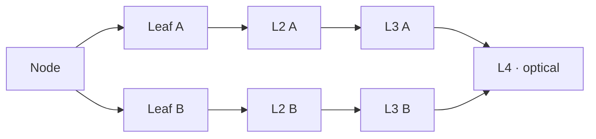

In June 2026, LineShine took first place on the TOP500. It runs HPL at 2.198 EFlop/s, about 21% ahead of El Capitan, and it does it without a single GPU. Every flop comes from Arm CPUs. The National Supercomputing Center in Shenzhen (NSCS) operates it.

The last Chinese machine at the top was Sunway TaihuLight, in 2017. China had stopped submitting to the list after 2019, and the usual explanation is US export controls on high-end GPUs. LineShine is the answer to that constraint. If you cannot buy accelerators, you build a CPU wide enough to act like one.

A caveat before the numbers. Most of what is public comes from an NSCS paper, the TOP500 entry and press analysis. A few figures disagree between sources. I flag those where they come up, and I mark the numbers I derived myself.

## The numbers that matter

| | LineShine | El Capitan |
| --- | --- | --- |
| HPL (Rmax) | 2,198.4 PFlop/s | 1,809 PFlop/s |
| Peak (Rpeak) | 2,735.8 PFlop/s | |
| HPL / peak | 80.4% | |
| Power during HPL | 42.2 MW | |
| Efficiency | 52.1 GFlop/s per W | 60.9 GFlop/s per W |
| Cores | 13,789,440 | |
| HPCG | 22.0 PFlop/s, first | |

So LineShine is the fastest machine on the list, but not the most frugal: it draws 42 MW, where Frontier, El Capitan and Aurora each stay under 30 MW. That is the cost of doing everything on CPUs.

## From the cabinet down to the core

| Level | Holds | In the HPL run |
| --- | --- | --- |
| System | 90 compute cabinets | |
| Cabinet | 2 frames | |
| Frame | 16 blades | |
| Blade | 8 nodes, linked by PCIe 5.0 | |
| Node | 2 LX2 sockets, 608 cores | 22,680 nodes |
| Socket | 2 dies, 304 cores | 45,360 sockets |
| Die | 4 NUMA domains of 38 cores | 90,720 dies |

The counts are consistent with each other: 90 × 2 × 16 × 8 gives 23,040 node slots. The HPL run used 22,680 nodes, which is 98% of them, and 22,680 × 608 is exactly the 13,789,440 cores on the list. The NSCS paper describes a smaller configuration of 20,480 nodes, which is probably what was installed when it was written. Glenn Lockwood counts 184 compute frames on the floor plan shown at ISC, which would be 23,552 nodes, so the machine may be a little larger than the run.

The building is stacked by function: cooling on the first floor, compute on the second, storage on the third. Compute cabinets sit in rows of 14, next to 6 network cabinets per row. The HPL run took 16,181 seconds, about four and a half hours.

## The LX2 chip

LX2 is an Armv9 processor with SVE2 vector units and SME matrix units, both 512 bits wide. NSCS calls the platform LingKun and has not said who designed the chip; most analysts attribute it to Huawei's HiSilicon. A socket holds two compute dies of 152 cores each. Each die is split into four clusters of 38 cores, and each cluster is a NUMA domain with its own L2, its own HBM stack and a share of the DDR.

| Per socket | Value |
| --- | --- |
| Cores | 304 at 1.55 GHz |
| FP64 peak | 60.3 TFlop/s |
| FP32 peak | 120.6 TFlop/s |
| BF16 / FP16 peak | 240 TFlop/s |
| INT8 peak | 960 TOp/s |
| L1 per core | 32 KB instruction + 32 KB data |
| L2 per cluster | 28.5 MB, shared by 38 cores |
| HBM | 8 stacks of 4 GB, 32 GB, 4 TB/s peak |
| DDR | 256 GB, off package, 128 GB per die |
| Network | one 800 Gb/s NIC, integrated |
| Power | about 690 W |

The figure worth doing by hand is the throughput per core:

$$
\frac{60.3 \times 10^{12}}{304 \times 1.55 \times 10^{9}} \approx 128 \ \text{FP64 flop per cycle per core}
$$

That is a lot for a CPU core. A 512-bit SVE unit with two FMA pipes gives 32. The rest comes from the matrix unit: each core has one 512-bit SME engine that does an 8 × 8 FP64 outer product (`FMOPA`) per cycle, which is 64 FMAs, or 128 flops. Dongarra's report on the system confirms that figure. It also explains the low clock: 1.55 GHz leaves the power budget to wide math rather than speed.

The catch is that only code shaped like a matrix product reaches that peak. HPL is exactly that, which is why the machine looks so strong on the list. A loop that the compiler vectorises with SVE gets a quarter of it at best.

The L2 is generous: 28.5 MB for 38 cores is 750 KB per core, more than most server chips offer. There is no L3 mentioned anywhere. HBM plays that role.

### Memory

Each socket has eight HBM stacks of 4 GB, one per cluster: 32 GB and 4 TB/s peak, probably HBM2E. The Next Platform first read the die layout as sixteen stacks, 64 GB per socket, which matches the per-node figure (two sockets). Dongarra's report and the later papers agree on 32 GB per socket. Measured, a stack delivers about 450 GB/s, so 3.6 TB/s per socket in practice.

The ratio is what matters for real code. At 4 TB/s for 60.3 TFlop/s, a socket gets about 0.066 bytes per flop, close to a Frontier MI250X (3.2 TB/s for 47.9 TFlop/s). In other words, LineShine has the bandwidth balance of a GPU machine. A stencil or a sparse solver will be bound by memory long before it reaches the SME units. The HPCG result agrees: 22 PFlop/s is 0.8% of peak, which is typical of every large machine, GPU or not.

Behind the HBM sits 256 GB of DDR per socket, 128 GB per die, measured at about 125 GB/s per die. The memory type is not published; Lockwood guesses DDR5. Dedicated SDMA engines copy data between the two tiers, the same idea as MCDRAM on Knights Landing. That gives each socket a fast 32 GB and a slow 256 GB, with roughly a 15× gap in bandwidth between them. Something has to decide what lives in HBM, and on LineShine that is your problem or your runtime's.

## The LingQi network

Each LX2 has an 800 Gb/s NIC built in, so a node has two, 1.6 Tb/s in total. The fabric is called LingQi (LQLink in some papers) and was designed in China. Each of a node's two NICs goes to its own, fully separate fat tree.

Each plane is a four-level fat tree. Lockwood reconstructed it from the network diagram shown at ISC, so read these counts as an informed estimate:

| Level | Switches | Links |
| --- | --- | --- |
| L1, host leaf | 2,944 | copper to the nodes, 8 × 100G up |
| L2, frame spine | 1,472 | 16 down, 8 optical up, 2:1 taper |
| L3, core leaf | 512 | optical down, copper up |
| L4, core spine | 192 | copper |

Only the L2 to L3 hop is optical, which keeps the cost of the fabric down. The links look like 100G lanes on 32-port switch ASICs. The tree is not full bisection: Lockwood estimates a taper of about 7.7:1 between the nodes and the top. The published figures are a single-hop latency of 1.07 µs and more than 3.5 Pb/s of bisection bandwidth.

HPCwire describes InfiniBand-like features such as credit-based flow control; others suspect an Ethernet variant. Software talks to it through UCX, so MPI and the rest do not need to care.

One more line of arithmetic: 200 GB/s per node for 120.6 TFlop/s is about 0.0017 bytes per flop. That is normal for an exascale machine. What it means is that a well-written code keeps its halo exchanges small and its collectives rare, on LineShine as on Frontier.

## Software

The nodes run Kylin, a Chinese Linux distribution. The rest of the stack is mostly Huawei's Kunpeng tooling:

| Layer | What runs |
| --- | --- |
| OS | Kylin Linux |
| BLAS | Kunpeng Math Library, OpenBLAS |
| MPI | Hyper MPI, Open MPI |
| Transport | UCX over LingQi |
| ML | PyTorch with an asynchronous MPI runtime |

The PyTorch detail is telling. On a GPU, CUDA streams let communication overlap with compute. The CPU backend has nothing like that, so the teams training models on LineShine wrote an asynchronous MPI runtime to get the overlap back.

Getting SME used by real applications, not just by HPL's DGEMM, is the open question. Today that mostly means BLAS libraries and compilers that know how to emit matrix instructions.

### Storage

About 200 PB on 428 storage nodes in 67 cabinets, split into a fast tier and a capacity tier of SSD and HDD pools, with roughly 10 TB/s on the fast tier. It is liquid-cooled, and NSCS plans to grow it to an exabyte. Wikipedia quotes 650 PB, which may be the planned size rather than what is installed.

## What to take from it

- An exaflop on CPUs alone is possible. It costs at least 40% more power than the GPU machines it beat.
- The matrix unit is the accelerator. It just happens to live inside each core instead of on a separate card.
- For memory-bound code the machine looks like a GPU system: about 0.07 bytes per flop from HBM, and a second, slower DDR tier to manage.
- 80% HPL efficiency is good but not exceptional; Fugaku reached 82%.

Sources: the [TOP500 June 2026 list](https://top500.org/lists/top500/2026/06/), Jack Dongarra's *Report on the Chinese LineShine System* (ICL-UT-26-01), [Glenn Lockwood on the LX2](https://glennklockwood.com/garden/processors/lx2), [arXiv:2605.08633](https://arxiv.org/abs/2605.08633) for the measured bandwidths, [The Next Platform](https://www.nextplatform.com/hpc/2026/06/25/a-deep-dive-on-chinas-lineshine-all-cpu-exaflops-class-supercomputer/5262439), [HPCwire](https://www.hpcwire.com/2026/06/25/inside-lineshine-the-new-chinese-supercomputer-sitting-atop-the-top500/), [Tom's Hardware](https://www.tomshardware.com/tech-industry/supercomputers/china-tops-the-top500-with-a-cpu-only-supercomputer-ending-el-capitans-reign), [Glenn Lockwood on the system](https://glennklockwood.com/garden/systems/LineShine) and [Wikipedia](https://en.wikipedia.org/wiki/LineShine).
