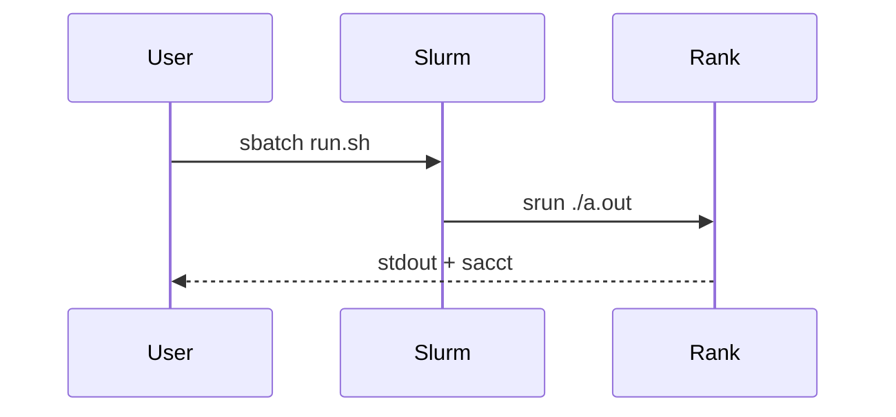

A note is a `.md` file with a short header. The body is ordinary Markdown: headings, lists, tables, quotes, code, diagrams, maths, images, and gifs.

> Walltime is a contract. The login node is not a workstation.

## Code

Fence a block and name the language. Copy sits on the block; longer listings collapse.

```bash
#!/bin/bash
#SBATCH --job-name=ping
#SBATCH --ntasks=4
#SBATCH --time=00:10:00
srun ./a.out
```

Inline names stay in a code span: `srun`, `MPI_Init`, `$SLURM_NTASKS`.

```cpp
#include <mpi.h>
int main(int argc, char** argv) {
  MPI_Init(&argc, &argv);
  MPI_Finalize();
}
```

## Diagrams

A `mermaid` fence becomes a figure. Flowcharts, sequence charts, and the rest of the Mermaid dialects are fair game.




## Maths

Inline TeX sits in dollar signs: a naive GEMM is $2n^3$ flops. Displayed expressions use a `math` fence, `$$…$$`, or `\[…\]`.

```math
E(p) = \frac{T_1}{p \, T_p}
```

$$
T_p = T_{\text{comp}} + T_{\text{comm}} + T_{\text{I/O}}
$$

Strong scaling is the ratio of serial time to $p$ times parallel time. If $E(p)$ falls over while the solver is "MPI bound", time the I/O.

## Figures and gifs

A Markdown image is a figure. Put files in `public/media/` and link them with `/media/…`. Click a still for a lightbox. GIFs animate in place and in the lightbox. A `.mp4` or `.webm` is a video.


## Tables and checklists

| Probe | What it answers |
| --- | --- |
| `sacct -j` | TIMEOUT, OOM, or a traceback |
| `nvidia-smi` | Whether the allocation saw a GPU |
| A timer around VTK | Whether the "MPI problem" is output |

- [x] Tiny kernel on one GPU
- [x] One production timestep
- [ ] Multi-node GPU-aware MPI

None of this replaces the centre handbook. It is just what a short note is allowed to hold. For the habit behind the gif, start with [Login nodes are not compute](/notes/login-nodes-are-not-compute).
